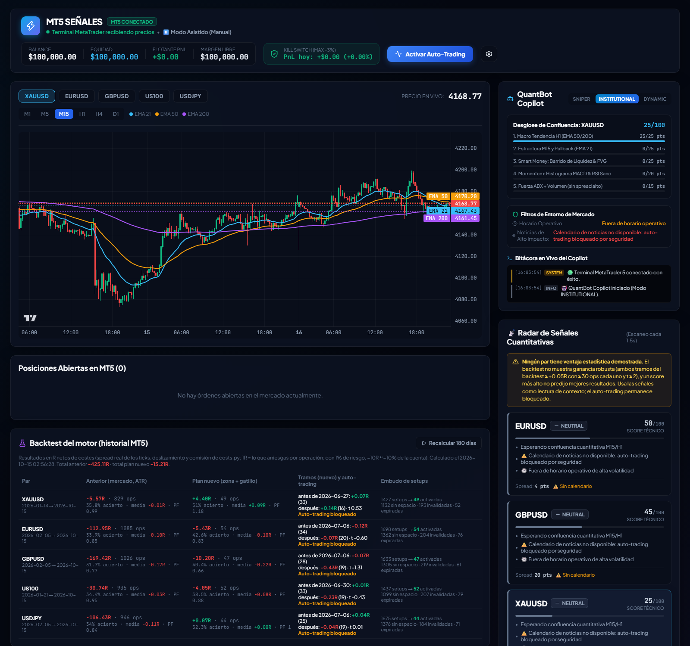
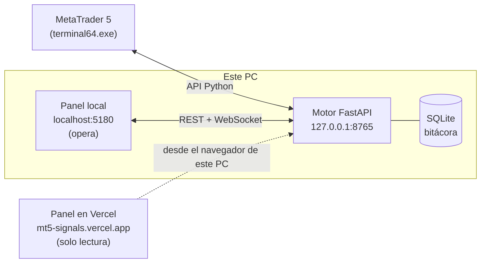

<div align="center">


# MT5 Señales

**Terminal de señales y gestión de riesgo para MetaTrader 5, con un laboratorio que no deja automatizar lo que no está demostrado.**

[](https://github.com/leonardeco/MT5-Signals/actions/workflows/ci.yml)


[](https://mt5-signals.vercel.app)

[Panel publicado](https://mt5-signals.vercel.app) · [Guía de uso](docs/guia-de-uso.md) · [Arquitectura](docs/arquitectura.md) · [API](docs/api.md) · [Investigación](docs/investigacion.md)

</div>



## Qué hace

| | |
|---|---|
| **Radar de señales** | Escanea XAUUSD, EURUSD, GBPUSD, US100 y USDJPY cada 1,5 s. Cada plan tiene zona de entrada, gatillo en M5, SL por estructura, y TP1/TP2 con su R. |
| **Riesgo primero** | Lote calculado en el servidor al 1 % por operación, kill switch al −3 % diario, filtro de noticias de alto impacto, límite de exposición por divisa y cierre de emergencia que solo toca las órdenes del bot. |
| **Ejecución real** | Órdenes divididas en dos patas para que el broker cierre el parcial en TP1 aunque la app esté apagada, reintento ante recotización y deslizamiento medido. |
| **Backtest con costes** | Usa el mismo código que el escáner, con spread real, comisión y deslizamiento por símbolo, y lo divide en tramos antiguo y reciente. |
| **Prueba en sombra** | Las reglas quedan congeladas con su huella SHA-256 y se miden solo con datos posteriores, sin enviar órdenes. |
| **Diario** | R por operación, MAE/MFE, expectativa por símbolo y comparación entre lo vivido y el backtest. |

## Estado honesto

> [!IMPORTANT]
> **El auto-trading está bloqueado.** Ningún par del motor intradía supera el filtro (ambos tramos ≥ +0,05R, ≥ 30 operaciones por tramo y t ≥ 2, netos de costes). La mejor hipótesis, tendencia de 12 meses en D1, da +0,067R y t 2,22, pero su Sharpe deflactado (0,61) no llega al 0,95 fijado antes de mirar los datos. Las señales se usan como lectura de contexto y la prueba a futuro sigue acumulando datos.

Más detalle en [Investigación](docs/investigacion.md).

## Arranque rápido

**Requisitos:** Windows, MetaTrader 5 con sesión iniciada (demo mientras dure la prueba), Python 3.12 y Node 24.

```powershell
git clone https://github.com/leonardeco/MT5-Signals.git
cd MT5-Signals
pip install -r requirements.txt
start_terminal.bat
```

`start_terminal.bat` abre MetaTrader si hace falta, arranca el motor en `127.0.0.1:8765` y el panel en [http://localhost:5180](http://localhost:5180), y abre el navegador cuando el motor responde. Si otro programa ocupa uno de esos puertos, lo dice en vez de arrancar a medias.

## Cómo encaja



El panel de Vercel es la misma aplicación servida como página estática. No tiene servidor propio: es el navegador el que habla con el motor de tu PC, así que solo funciona en el equipo donde corre MetaTrader. Por defecto **solo puede leer**: las órdenes salen del panel local. Se puede cambiar en [Despliegue](docs/despliegue.md#permisos-del-panel-publicado).

## Documentación

| Documento | Contenido |
|---|---|
| [Guía de uso](docs/guia-de-uso.md) | Rutina diaria, qué significa cada panel y solución de problemas |
| [Arquitectura](docs/arquitectura.md) | Módulos, ciclo del escáner, ciclo de vida de una señal y datos |
| [API del motor](docs/api.md) | Endpoints REST y WebSocket |
| [Riesgo y seguridad](docs/riesgo-y-seguridad.md) | Capas de protección de la cuenta y del motor |
| [Investigación](docs/investigacion.md) | Evidencia, criterio de ventaja y cómo probar una idea nueva |
| [Despliegue](docs/despliegue.md) | GitHub, Vercel, CI e integraciones |
| [Constitución](docs/constitution.md) | Reglas que ningún cambio puede romper |

## Desarrollo

```powershell
pip install -r requirements-dev.txt
python -m pytest tests -q          # motor
cd frontend; npm ci; npm run lint; npm run build   # panel
```

Cada push a `main` pasa por GitHub Actions (tests en Windows, lint y build del panel) y Vercel publica el panel automáticamente.

---

<sub>Herramienta personal de análisis. Nada de lo que muestra es una recomendación de inversión; operar con apalancamiento puede hacer perder más de lo invertido.</sub>
