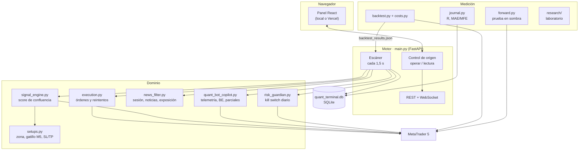
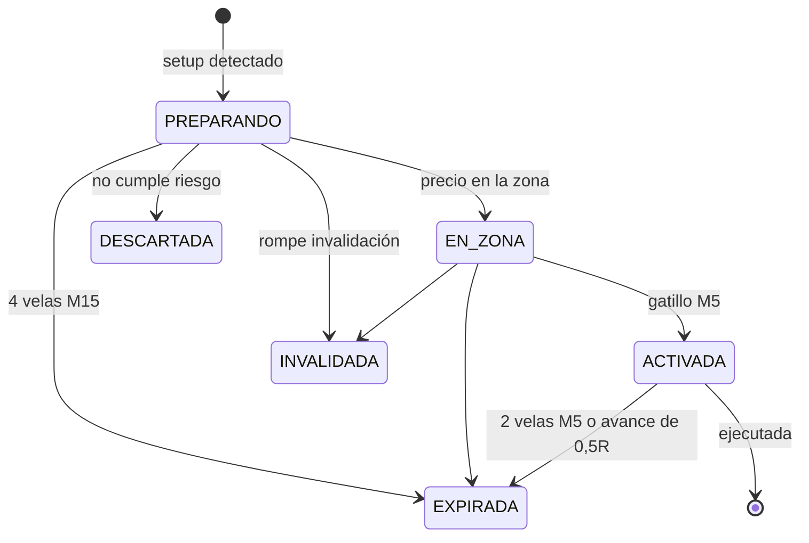

# Arquitectura

## Vista general

## Ciclo del escáner

En cada vuelta, cada 1,5 s, `market_scanner_loop` hace esto:

1. Si MT5 no responde, reintenta conectar cada 5 s. Sin MT5 no hay señales: solo un marcador `OFFLINE` y velas simuladas para la vista.
2. El kill switch compara la equidad con el balance de inicio del día. Al llegar a −3 % bloquea y apaga el auto-trading.
3. Sincroniza la bitácora con el historial de MT5 y gestiona breakeven y parciales de las posiciones del bot.
4. Por cada símbolo:
   - `signal_engine` puntúa la confluencia (tendencia H1, estructura M15, liquidez, momentum y coste);
   - `setups` construye el plan y su estado;
   - `history_for` adjunta el resultado del backtest en ese rango de score;
   - `news_filter` evalúa sesión, noticias y exposición.
5. Solo si **todo** se cumple, el auto-trading envía el plan: interruptor encendido, sin bloqueo, entorno permitido, copiloto aprobado, plan ejecutable, `history_allows_auto` y sin posición en el símbolo.
6. Difunde un `MARKET_UPDATE` por WebSocket y lo deja disponible en `GET /market`.

## Ciclo de vida de una señal

## Módulos

| Archivo | Responsabilidad |
|---|---|
| `main.py` | API, escáner, control de origen, auto-trading y lote limitado por riesgo |
| `signal_engine.py` | Resolución de símbolos del broker, score de confluencia y lote al 1 % |
| `setups.py` | Planes de zona y gatillo, SL por estructura y TP por niveles |
| `quant_bot_copilot.py` | Modos de score mínimo (SNIPER 85, INSTITUTIONAL 75, DYNAMIC 65), bitácora, breakeven y parciales |
| `news_filter.py` | Sesión, calendario de alto impacto (con caché en disco) y exposición por divisa |
| `risk_guardian.py` | Kill switch diario persistente y cierre de emergencia por `MAGIC_NUMBER` |
| `execution.py` | Validación de niveles, modos de llenado, reintentos con tick nuevo y órdenes divididas |
| `database.py` | Tablas SQLite y sincronización con el historial de MT5 |
| `journal.py` | R, MAE/MFE y expectativa |
| `backtest.py` · `costs.py` | Backtest con el mismo código del escáner y costes reales |
| `forward.py` | Congelación de reglas y prueba en sombra |
| `research/` | Datos largos, registro de hipótesis, métricas de robustez y laboratorio |
| `frontend/` | Panel React + Vite + lightweight-charts |

## Archivos de datos

| Archivo | En git | Contenido |
|---|---|---|
| `quant_terminal.db` | No | Operaciones, señales, eventos del kill switch y estado diario |
| `news_cache.json` | No | Última descarga buena del calendario |
| `allowed_origins.local` | No | Orígenes extra y su permiso |
| `research/cache/` | No | Historial MT5 en caché (≈ 85 MB) |
| `backtest_results.json` | Sí | Último backtest; alimenta el filtro del auto-trading |
| `forward_config.json` | Sí | Fecha de congelación y huellas de las reglas |
| `forward_results.json` | Sí | Último cálculo de la prueba a futuro |
| `costes.json` | Sí | Costes por símbolo |
| `research/registro_hipotesis.json` | Sí | Todas las hipótesis y su criterio |
