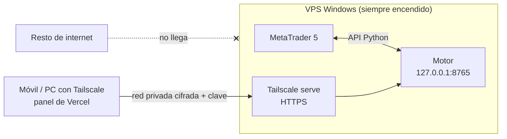

# Motor en un VPS (sin depender de tu PC)

Con esto, MetaTrader 5 y el motor funcionan en un servidor Windows en la nube, encendido 24 horas al día, 5 días a la
semana. Tu PC puede estar apagado. Desde el móvil o cualquier navegador abres el
[panel publicado](https://mt5-signals.vercel.app) y este habla con el VPS.

La exactitud no cambia: es el mismo código con los mismos precios de tu broker, porque MT5 sigue siendo la fuente.



Dos capas de protección:

1. **Red privada (Tailscale).** El motor no se abre a internet: solo tus dispositivos, con tu cuenta de Tailscale,
   pueden llegar a él. No se abre ningún puerto en el VPS.
2. **Clave del motor.** Aunque alguien entrara en tu red privada, sin la clave no ve ni toca nada. La de lectura solo
   mira; solo la de operar envía órdenes.

> [!WARNING]
> **Un solo motor por cuenta.** Si el motor de tu PC y el del VPS corren a la vez sobre la misma cuenta, los dos
> gestionan las mismas posiciones y, con auto-trading, los dos abrirían órdenes. Cuando el VPS funcione, no vuelvas a
> ejecutar `start_terminal.bat` en el PC con esa cuenta.

## 1. Contratar el VPS

| Requisito | Valor |
|---|---|
| Sistema | Windows Server 2022 o Windows 10/11 |
| CPU y memoria | 2 vCPU y 4 GB de RAM como mínimo (MT5 + Python + pandas) |
| Disco | 40 GB o más |
| Ubicación | Cerca del servidor de tu broker: menos latencia en las órdenes |
| Precio orientativo | Entre 10 y 30 USD al mes |

Sirve cualquier proveedor que dé Windows con escritorio remoto (RDP). Los "VPS para forex" ya vienen preparados y
cerca de los servidores de los brokers.

## 2. Preparar Windows

Entra por escritorio remoto y, en una consola de administrador:

```powershell
# Misma zona horaria que tú: el kill switch reinicia el día a medianoche de la hora del VPS
tzutil /s "SA Pacific Standard Time"
```

En *Configuración → Windows Update → Opciones avanzadas*, pon las horas activas en el horario de mercado, para que no
se reinicie en mitad de la sesión. Mejor aún, programa los reinicios para el fin de semana.

## 3. MetaTrader 5

1. Instala MT5 de tu broker en la ruta por defecto (`C:\Program Files\MetaTrader 5`).
2. Inicia sesión en tu cuenta y marca **Guardar contraseña**, para que reconecte solo tras un reinicio.
3. *Herramientas → Opciones → Asesores Expertos*: activa **Permitir el trading algorítmico**.
4. Deja activado el botón **Algo Trading** de la barra superior.

## 4. Motor

Instala [Python 3.12](https://www.python.org/downloads/) (marca *Add to PATH*) y [Git](https://git-scm.com/download/win).
Después:

```powershell
cd C:\
git clone https://github.com/leonardeco/MT5-Signals.git
cd MT5-Signals
pip install -r requirements.txt
```

Si quieres conservar el historial, copia desde tu PC a la misma carpeta del VPS:
- `quant_terminal.db`: bitácora, diario y estado del kill switch.
- `research\cache\`: historial para el laboratorio.

## 5. Claves y permisos

Genera dos claves distintas:

```powershell
python -c "import secrets; print(secrets.token_urlsafe(32))"   # para operar
python -c "import secrets; print(secrets.token_urlsafe(32))"   # para solo lectura
```

Copia `motor.env.example` a `motor.env` y pégalas:

```text
MT5_TOKEN_OPERAR=<la primera>
MT5_TOKEN_LECTURA=<la segunda>
```

Crea `allowed_origins.local` con el panel publicado:

```text
https://mt5-signals.vercel.app
```

Con claves activas, lo que se puede hacer lo decide la clave, no esta lista. La lista solo dice desde qué páginas se
acepta la conexión.

Guarda las claves en tu gestor de contraseñas. `motor.env` no se sube a git.

## 6. Arranque automático

MT5 es un programa de escritorio y solo funciona con una sesión de usuario abierta. Por eso:

1. **Inicio de sesión automático.** Descarga [Autologon de Microsoft Sysinternals](https://learn.microsoft.com/sysinternals/downloads/autologon),
   ejecútalo y pon el usuario y la contraseña de Windows del VPS. La contraseña queda cifrada en el sistema.
2. **Tarea al iniciar sesión.** En una consola de administrador:

   ```powershell
   schtasks /create /tn "MT5 Senales Motor" /sc onlogon /rl highest /tr "\"C:\MT5-Signals\vps\arrancar_motor_vps.bat\""
   ```

`vps\arrancar_motor_vps.bat` hace lo siguiente:
- Se niega a arrancar si `motor.env` no tiene clave.
- Abre MT5 si no está abierto.
- Arranca el motor solo en `127.0.0.1`.
- Si el motor se cae, lo relanza a los 15 segundos.
- Guarda la salida en `motor.log`.

Para probar sin reiniciar, ejecuta la tarea: `schtasks /run /tn "MT5 Senales Motor"`.

> [!IMPORTANT]
> Para salir del escritorio remoto, **cierra la ventana** (desconectar). No uses *Cerrar sesión*: cerraría MT5 y el
> motor.

## 7. Acceso privado con Tailscale

1. Crea una cuenta gratuita en [tailscale.com](https://tailscale.com) e instala Tailscale **en el VPS** y **en cada
   dispositivo** desde el que vayas a mirar (móvil, PC). Usa la misma cuenta en todos.
2. En la consola de administración de Tailscale, en *DNS*, activa **MagicDNS** y **HTTPS Certificates**.
3. En el VPS, desde una consola de administrador:

   ```powershell
   tailscale serve --bg localhost:8765
   tailscale serve status
   ```

   `status` muestra la dirección, del tipo `https://<nombre-del-vps>.<tu-red>.ts.net`. Esta configuración se mantiene
   tras los reinicios.

Comprueba desde tu móvil, con Tailscale activo, abriendo `https://<nombre-del-vps>.<tu-red>.ts.net/status`. Debe
responder `"service":"mt5-senales"` y `"auth_required":true`, sin ningún dato de la cuenta.

## 8. Conectar el panel

1. Abre [mt5-signals.vercel.app](https://mt5-signals.vercel.app) en un dispositivo con Tailscale activo.
2. Pulsa el engranaje (arriba a la derecha):
   - **Dirección del motor:** `https://<nombre-del-vps>.<tu-red>.ts.net`
   - **Clave:** la de operar, o la de lectura en dispositivos desde los que solo quieras mirar.
3. Pulsa *Guardar y recargar*. La cabecera debe decir **MT5 CONECTADO**.

La clave se guarda solo en ese navegador. Si pierdes un dispositivo, cambia las claves en `motor.env` del VPS y
reinicia el motor: las anteriores dejan de valer al momento.

## Mantenimiento

| Qué | Cómo |
|---|---|
| Actualizar el motor | `cd C:\MT5-Signals`, `git pull`, cierra la ventana del motor (la tarea lo relanza) |
| Ver qué pasa | `motor.log` en la carpeta del motor |
| Cambiar las claves | Edita `motor.env` y reinicia el motor |
| Cortar el acceso remoto | `tailscale serve off` en el VPS |
| Volver al PC | Para la tarea en el VPS (`schtasks /end /tn "MT5 Senales Motor"`) y cierra MT5 allí antes de arrancar `start_terminal.bat` en el PC |

## Qué no hacer

- **No abrir el puerto 8765** en el firewall del VPS ni arrancar el motor con `--host 0.0.0.0`. Todo el acceso entra
  por Tailscale.
- **No dejar el motor sin `motor.env`** en el VPS. El script de arranque lo impide, pero un arranque a mano no.
- **No usar un túnel público** (Cloudflare Tunnel, ngrok) sin una capa de acceso delante. La clave protege, pero una
  red privada evita además que cualquiera pueda siquiera intentarlo.
